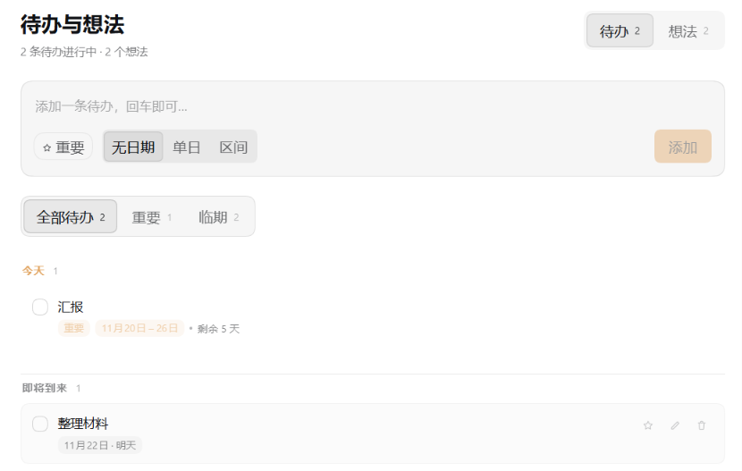
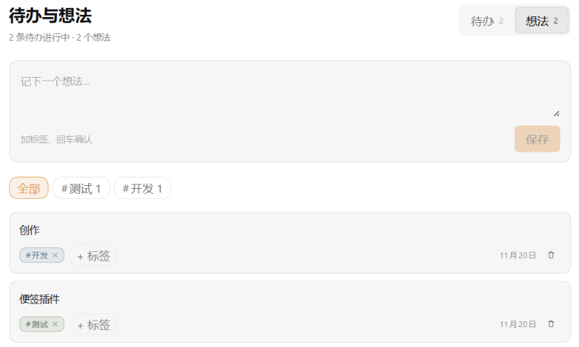

# dsh-utodo

> A todo list and idea notebook that lives in the [DeepSeek Harness](https://github.com/deepseek-ai/deepseek-harness) sidebar — one click away from every conversation.

[](LICENSE)
[](https://github.com/deepseek-ai/deepseek-harness)
[](package.json)
[](https://www.npmjs.com/package/dsh-utodo)

**简体中文** → [README.md](README.md)

## Screenshots





## Why

Notes and todos usually live in a separate app, so they drift away from the work they belong to. `dsh-utodo` puts a lightweight, keyboard-friendly panel in the DeepSeek Harness sidebar: capture a task or a thought without leaving the window, organise it with dates or tags, and get it back when you need it. Everything stays in your own browser storage — no account, no server, no telemetry.

## Features

### Todos

- **Flexible scheduling** — no date, a single day, or a **date range**. A running range shows how many days are left, and a range is judged by its deadline.
- **Smart grouping** — overdue, today, upcoming, no date, done.
- **Important flag** — star any task with ☆; the star is visible in the `important` view.
- **Soon window** — list everything due within *N* days, where *N* can be `2 / 7 / 30` presets or any value from 1 to 365. The value is persisted.
- **Three switchable views** (with live counts): all todos, important, soon.
- **Quick capture** — type a title, press `Enter`.

### Ideas

- Free-form notes with **any number of tags**.
- A tag bar filters the list and shows per-tag counts.
- Tags are added with `Enter` or `,`, removed with click or `Backspace`.

### Tag colours

Six low-saturation Morandi tones, assigned by first appearance so the first six tags are always visually distinct:

| Tone | Hex | Contrast on white |
| --- | --- | --- |
| Fog blue | `#5c7893` | 4.60 |
| Sage green | `#67805e` | 4.35 |
| Bean red | `#966c6c` | 4.51 |
| Lotus purple | `#75618c` | 5.46 |
| Camel apricot | `#8b724a` | 4.56 |
| Ink teal | `#3d5f68` | 6.92 |

Pairwise distance is at least ΔE ≈ 16 in CIELAB space, comfortably above the ~10 threshold where two colours of this size stop being distinguishable. The assignment is stored in `settings.tagTones`, so a tag keeps its colour across sessions, and a tag typed in the composer already previews the colour it will get after saving.

## Requirements

- **DeepSeek Harness** desktop application (developed and tested against `0.2.2-rc.3`). The plugin relies on the client slot API (`ctx.slots`) and the `__ModuleLoader__` bundle format.
- **Node.js ≥ 20** — only for running the checks; the plugin itself has no build step and no runtime dependencies beyond the platform-provided `react`.

## Install

Install it from npm (the package is also installable straight from GitHub — see below):

```bash
dsh plugin --profile desktop add dsh-utodo
```

From GitHub instead, when you want to track the repository without npm:

```bash
dsh plugin --profile desktop add "github:HauWong/dsh-utodo"
```

Or clone it and link the checkout, which is what you want while developing:

```bash
git clone https://github.com/HauWong/dsh-utodo.git
dsh plugin --profile desktop add link:"/absolute/path/to/dsh-utodo"
```

`dsh plugin` forwards its arguments to `pnpm` in the profile directory and reconciles `dsh.profile.bundles` from the package's `cordis.patch.yml`, so there is nothing to edit by hand.

> **Restart DeepSeek Harness after installing or updating.** The client module graph is composed at application start from the enabled Loader entries; the sidebar entry appears only after a restart (the panel is pinned by default).

To remove it:

```bash
dsh plugin --profile desktop remove dsh-utodo
```

## Usage

Open **待办与想法** in the left sidebar.

| Action | How |
| --- | --- |
| Add a todo | Type in the composer, press `Enter` |
| Pick a date | `单日` for one day, `区间` for a range, or the quick picks (today / tomorrow / next Monday) |
| Mark important | Click ☆ on the row (or toggle it in the composer) |
| Edit a todo | Double-click its title — title and dates are editable inline |
| Delete anything | Click the delete control; it asks for a second click |
| Switch todo view | The tabs at the top: 全部待办 / 重要 / 临期 |
| Change the soon window | Presets `2 / 7 / 30` or the number field next to 临期 |
| Add an idea | Type, add tags, then `Ctrl/Cmd + Enter` |
| Filter by tag | Click a tag in the bar above the list |
| Edit an idea | Double-click its text |

## Data & privacy

All state lives in the WebView's `localStorage` under the key `dsh-utodo.v1`. Nothing is sent anywhere: no network requests, no analytics, no account.

```jsonc
{
  "todos": [{ "id": "…", "title": "…", "start": "2026-11-20", "end": "2026-11-24", "done": false, "important": true, "createdAt": 0 }],
  "ideas": [{ "id": "…", "text": "…", "tags": ["dsh"], "createdAt": 0 }],
  "settings": { "soonDays": 2, "tagTones": { "dsh": 0 } }
}
```

Dates are ISO `YYYY-MM-DD`; an empty `end` means a single-day task. Data written by older versions is migrated on load — missing fields are filled in and tag tones are assigned automatically.

Because it is local storage, clearing site data for the app removes your list. There is no export/import yet; the JSON above is the entire format, so a manual copy of that key is a valid backup.

## How it works

A DSH plugin ships two halves: a host entry (Cordis plugin) and, optionally, a client bundle for the Web UI.

| Path | Role |
| --- | --- |
| `package.json` | Package metadata plus the `dsh.bundle` / `dsh.client` manifests |
| `cordis.patch.yml` | Inserts the Loader entry `utodo` into the profile |
| `lib/index.js` | Host half — intentionally empty (`inject = []`, no-op `apply`), it exists so the entry is enabled and the client bundle can be served |
| `lib/client.js` | The whole UI: sidebar icon + panel, written by hand in the `window.__ModuleLoader__` bundle format |

The client half registers two slots:

```js
ctx.slots.inject('sidebar.panellist', () => ctx.slots.register(
  { name: 'sidebar.panellist', id: 'utodo', order: 20, label: () => '待办与想法' },
  PanelIcon,
))

ctx.slots.inject('main', () => ctx.slots.register(
  { name: 'main', key: 'utodo' },
  UtodoPage,
))
```

`sidebar.panellist` contributes the sidebar row and receives the icon through the `sidebar.panel.icon` factory; `main` is matched by the layout through `key` when that row is selected. Styles are injected as a single `<style>` element from inside the bundle and use semi-transparent neutral colours plus one accent (`#e0a15b`), so the panel reads correctly in both light and dark themes. There is no bundler: the file is plain ESM wrapped in a loader call, which keeps review and hot fixes trivial.

## Development

```bash
node --check lib/client.js          # syntax only
node .recon/smoke.mjs               # renders the panel with a fake React, checks grouping, ranges, views, tag colours
node .recon/smoke-register.mjs      # calls apply() with a fake ctx.slots, checks the registered slots
```

Both scripts print a `failures` / `problems` list; empty means the assertions passed. `smoke.mjs` reports one known false positive about a placeholder, because placeholders are element attributes rather than text.

`.recon/` also holds the tooling used to study the host: an asar indexer/reader and an asar grep helper. It is development scaffolding and can be deleted without affecting the plugin.

## Limitations

- Not on npm; install from GitHub or a local link.
- Local storage only — no sync, no export/import, no multiple devices.
- Requires an application restart after install or update, because the client graph is composed at boot.
- Built against DSH `0.2.2-rc.3` slot names; a future host renderer change may require updates.

## Contributing

Issues and pull requests are welcome. Please keep the constraints the project relies on:

- No build step and no runtime dependencies for `lib/client.js` — only `react` / `react/jsx-runtime`, which the platform provides.
- Run the three checks above before opening a PR; keep the smoke assertions green.
- Match the existing visual language: neutral surfaces, one accent, the six-tone tag palette, no emoji as icons.

## License

MIT © 2026 HauWong — see [LICENSE](LICENSE).
