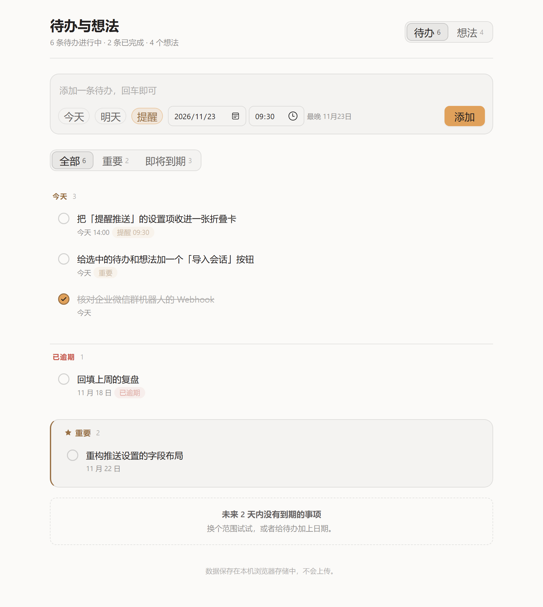
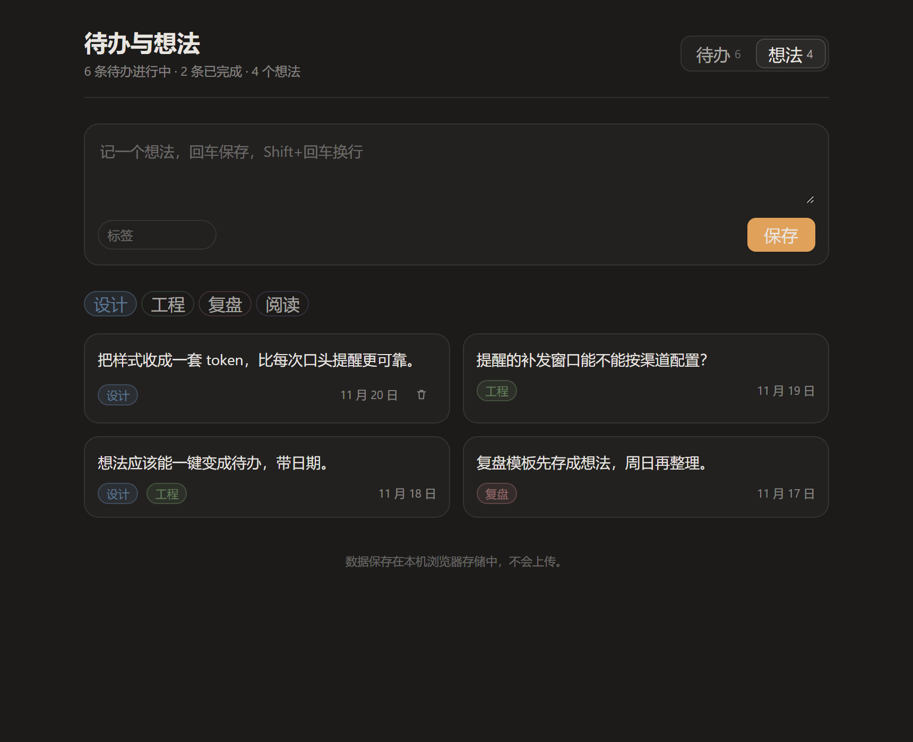

# dsh-utodo

> 常驻在 [DeepSeek Harness](https://github.com/deepseek-ai/deepseek-harness) 左侧栏的待办清单与想法速记本 —— 不离开当前窗口，随手记下，随时找回。

[](LICENSE)
[](https://github.com/deepseek-ai/deepseek-harness)
[](package.json)
[](https://www.npmjs.com/package/dsh-utodo)

**English** → [README-EN.md](README-EN.md)

## 截图





## 为什么做这个

待办和灵感通常散落在另一个 App 里，于是离它所属的工作越来越远。`dsh-utodo` 在 DeepSeek Harness 侧栏放一块轻量、可全键盘操作的面板：不用切窗口就能记一条待办或一个念头，用日期或标签把它组织起来，需要时再翻出来。数据只存在本机浏览器存储里 —— 没有账号、没有服务端、没有埋点。

## 功能

### 待办

- **灵活的时间设置**：不设日期、指定某一天，或指定一个**日期区间**。区间进行中会显示剩余天数，并且按**截止日**判定状态。
- **自动分组**：逾期 / 今天 / 即将到来 / 未设日期 / 已完成。
- **重要标记**：点 ☆ 即可标记，在「重要」视图里集中查看。
- **临期窗口**：列出未来 *N* 天内到期的未完成事项，*N* 可选 `2 / 7 / 30` 天预设，也可自定义 1–365 任意值，并会持久保存。
- **三个可切换视图**（各自带实时条数）：全部待办、重要、临期。
- **快速录入**：输入标题，回车即可。

### 想法

- 随手记，可加**任意多个标签**。
- 顶部标签栏按标签筛选，并显示每个标签的条数。
- 回车或逗号添加标签，点 × 或退格删除。

### 导入到会话

- 面板右上角点 **导入会话** 进入多选，勾选任意待办和想法。
- 点 **导入到当前会话**：选中的内容会以 Markdown 追加到当前对话的输入草稿（保留你已经输入的文字），界面切回会话并把光标放进输入框。
- 没有可用会话时，同样的文本会复制到剪贴板，选中结果不会丢。

### 提醒推送

- 任何待办都能设提醒：点输入框旁的 **提醒** 开一个日期（`YYYY-MM-DD`）加一个时间（`HH:mm`），到点后推送到微信。
- 提醒日可以提前到待办开始之前，但不能晚于待办的最后一天——区间待办用结束日当上限，输入框会自动夹住。
- 已完成的待办和已删除的待办都不会推送。
- 渠道在待办页底部的 **提醒推送设置** 里填（想法页不显示这张卡）：企业微信群机器人 Webhook、Server酱 SendKey、PushPlus token，或任意接收 `{title, content}` 的自定义 Webhook。
- 先点 **发送测试推送** 确认配置；也可以同时打开系统通知。
- 只在页面打开时投递。页面关着时到点的提醒，会在下次打开后的 6 小时内补发一次，更早的只做静默标记。

### 标签配色

只用六种低饱和莫兰迪色，按首次出现顺序分配，所以前六个标签一定彼此可辨：

| 色名 | 色值 | 白底对比度 |
| --- | --- | --- |
| 雾蓝 | `#5c7893` | 4.60 |
| 灰绿 | `#67805e` | 4.35 |
| 豆沙 | `#966c6c` | 4.51 |
| 藕紫 | `#75618c` | 5.46 |
| 驼杏 | `#8b724a` | 4.56 |
| 墨青 | `#3d5f68` | 6.92 |

两两之间 CIELAB 色差 ΔE ≥ 16，明显高于这个尺寸下颜色开始难以分辨的约 10 这一阈值。配色记录在 `settings.tagTones` 里，所以同一个标签在输入区、筛选条和每张卡片上颜色一致，重启后也不变；在输入框里刚打出的新标签，预览色就是它保存后会得到的颜色。

## 环境要求

- **DeepSeek Harness** 桌面端（开发与验证基于 `0.2.2-rc.3`）。插件依赖客户端插槽 API（`ctx.slots`）和 `__ModuleLoader__` bundle 格式。
- **Node.js ≥ 20** —— 仅用于跑自检脚本；插件本身没有构建步骤，除了平台提供的 `react` 之外没有运行时依赖。

## 安装

从 npm 安装（也可以直接从 GitHub 装，见下）：

```bash
dsh plugin --profile desktop add dsh-utodo
```

直接从 GitHub 安装（想跟着仓库走、不经过 npm 时用它）：

```bash
dsh plugin --profile desktop add "github:HauWong/dsh-utodo"
```

或者克隆后以 link 方式装入，开发时建议这样做：

```bash
git clone https://github.com/HauWong/dsh-utodo.git
dsh plugin --profile desktop add link:"/absolute/path/to/dsh-utodo"
```

`dsh plugin` 会把参数转发给 profile 目录下的 `pnpm`，并根据包内的 `cordis.patch.yml` 同步 `dsh.profile.bundles`，不需要手工改配置文件。

> **安装或更新后请重启 DeepSeek Harness。** 客户端模块图在应用启动时按已启用的 Loader 条目组装，重启后侧栏才会出现「待办与想法」入口（该面板默认已固定显示）。

卸载：

```bash
dsh plugin --profile desktop remove dsh-utodo
```

## 使用

在左侧栏打开 **待办与想法**。

| 操作 | 方式 |
| --- | --- |
| 新建待办 | 在输入框输入标题，回车 |
| 设置日期 | `单日` 选一天，`区间` 选一段，或用快捷项（今天 / 明天 / 下周一） |
| 设置提醒 | 点「提醒」开一个日期加时间；日期不能晚于待办最后一天 |
| 标记重要 | 点行右侧的 ☆（新建时也可在输入框旁切换） |
| 修改待办 | 双击标题，标题与日期都能就地编辑 |
| 删除 | 点删除键，需要再点一次确认 |
| 切换待办视图 | 顶部标签页：全部待办 / 重要 / 临期 |
| 调整临期窗口 | 点 `2 / 7 / 30` 预设，或在数字框里自定义 |
| 记录想法 | 输入内容、加标签，`Ctrl/Cmd + Enter` 保存 |
| 按标签筛选 | 点列表上方的标签条 |
| 修改想法 | 双击正文 |
| 导入到会话 | 点右上角「导入会话」勾选条目，再点「导入到当前会话」 |
| 设置提醒推送 | 待办页底部「提醒推送设置」，填渠道与密钥后发一条测试推送（想法页不显示） |

## 数据与隐私

全部状态存放在 WebView 的 `localStorage` 中，键名为 `dsh-utodo.v1`。没有统计、没有账号体系，数据不会发往任何第三方服务器：唯一的外发请求是提醒推送，且只会发到你亲自填写的那个 Webhook 或 token 对应地址。

```jsonc
{
  "todos": [{ "id": "…", "title": "…", "start": "2026-11-20", "end": null, "remind": "09:30", "remindDay": "2026-11-20", "remindSent": null, "done": false, "important": true, "createdAt": 0 }],
  "ideas": [{ "id": "…", "text": "…", "tags": ["dsh"], "createdAt": 0 }],
  "settings": {
    "soonDays": 2,
    "tagTones": { "dsh": 0 },
    "push": { "enabled": false, "channel": "wecom", "target": "", "desktop": false }
  }
}
```

日期统一是 ISO `YYYY-MM-DD`；`end` 为空表示单日事项。旧版本写入的数据会在加载时自动迁移：缺字段会补齐，标签配色会自动分配。

因为是本地存储，清除应用的站点数据会一并清空清单。目前还没有导入 / 导出功能，但上面就是完整的数据格式，手动备份这个键即可。

## 实现说明

一个 DSH 插件分为两部分：宿主入口（Cordis 插件）和可选的 Web 客户端 bundle。

| 路径 | 作用 |
| --- | --- |
| `package.json` | 包信息，以及 `dsh.bundle` / `dsh.client` 清单 |
| `cordis.patch.yml` | 向 profile 注入 Loader 条目 `utodo` |
| `lib/index.js` | 宿主端 —— 有意留空（`inject = []`，空 `apply`），作用只是让条目处于启用状态、并让客户端 bundle 能被提供 |
| `lib/client.js` | 全部界面：侧栏图标与主面板，手写的 `window.__ModuleLoader__` bundle |

客户端注册三个插槽：

```js
ctx.slots.inject('sidebar.panellist', () => ctx.slots.register(
  { name: 'sidebar.panellist', id: 'utodo', order: 20, label: () => '待办与想法' },
  PanelIcon,
))

ctx.slots.inject('main', () => ctx.slots.register(
  { name: 'main', key: 'utodo' },
  UtodoPage,
))
```

`sidebar.panellist` 提供侧栏那一行，图标通过 `sidebar.panel.icon` 工厂渲染；`main` 由布局层在选中该行时按 `key` 匹配。第三个注册是 `conversation.session.header.utilities` 上的空渲染探针 —— 主面板是 root 作用域，平台不会告诉它「当前会话」是哪个，探针从会话头拿到 id 并记下来，导入按钮再用它取 `conversation.input`。探针注册失败也不影响面板，导入会退回剪贴板。样式是 bundle 内注入的单个 `<style>` 元素，使用半透明中性色加一个强调色（`#e0a15b`），深浅主题下都可读。项目没有打包器：这个文件就是被 loader 包了一层的普通 ESM，方便审阅和快速修补。

## 开发

```bash
node --check lib/client.js          # 仅语法检查
node .recon/smoke.mjs               # 用假 React 渲染面板：分组、区间、视图、标签配色、提醒与导入文本
node .recon/smoke-register.mjs      # 用假 ctx.slots 跑 apply()，校验注册的插槽
node .recon/ui-audit.mjs            # 设计系统审计：token 覆盖、类名对齐、按钮类型
node .recon/preview.mjs             # 用当前样式生成 .recon/preview-{light,dark}.html
```

前三个脚本打印 `failures` / `problems` 列表，为空即通过；`ui-audit` 不合规时以非零码退出。`smoke.mjs` 会报一条已知误报，原因是占位符是元素属性而非文本。

`.recon/` 还包含研究宿主时用的工具（asar 索引 / 读取 / 搜索）和静态预览、截图脚手架：`preview.mjs` 生成整页预览，`shots.mjs` 生成 README 里的两张界面图（都直接套用线上样式表，改完样式重跑即可更新）。这些是开发脚手架，删除不影响插件本身。

## 设计约定

界面的全部样式集中在 `lib/client.js` 顶部的 `CSS` 字符串里：颜色、字号、圆角、间距都取自 `.utodo-root` 上的 `--ut-*` token，没有第二份样式表，也没有构建步骤。

- [`UI-GUIDELINES.md`](UI-GUIDELINES.md)：设计意图、token 表、组件配方、状态约定与 do/don't —— 改界面之前先读它。
- [`AGENTS.md`](AGENTS.md)：给代码代理（和新同事）的入口，含命令、工程约束与发布流程。

`node .recon/ui-audit.mjs` 机械地检查这些约定：颜色字面量只允许出现在 token 行、字号只能用 `--ut-fs-*`、圆角只能用 `--ut-r-*`、间距必须落在 4pt 标尺、JSX 类名与 CSS 规则双向对齐、每个 `<button>` 必须显式写 `type`。改完再用 `preview.mjs` 在亮/暗两种底色下看一眼。

## 已知限制

- npm 上只发稳定版本，仓库 `main` 可能领先一个版本；想跟最新代码请用 link 方式装本地仓库。
- 仅本地存储 —— 不支持同步、导入导出和多设备。
- 安装或更新后需要重启应用，因为客户端模块图在启动时组装。
- 针对 DSH `0.2.2-rc.3` 的插槽命名开发，宿主未来若调整渲染机制可能需要跟进。
- 提醒依赖本机时钟与页面进程：应用没开着就不会准点推送，只会在下次打开时补发 6 小时内的提醒。
- 推送只支持第三方通道（企业微信机器人 / Server酱 / PushPlus / 自定义 Webhook），不直接接入个人微信。

## 参与贡献

欢迎提 Issue 和 PR。请保持项目依赖的几条约束：

- `lib/client.js` 不引入构建步骤和运行时依赖，只用平台提供的 `react` / `react/jsx-runtime`。
- 提交 PR 前跑完上面三条检查，保持冒烟断言为绿。
- 延续现有视觉语言：中性表面、单一强调色、六色莫兰迪标签板，不用 emoji 充当图标。

## 许可证

MIT © 2026 HauWong —— 见 [LICENSE](LICENSE)。
